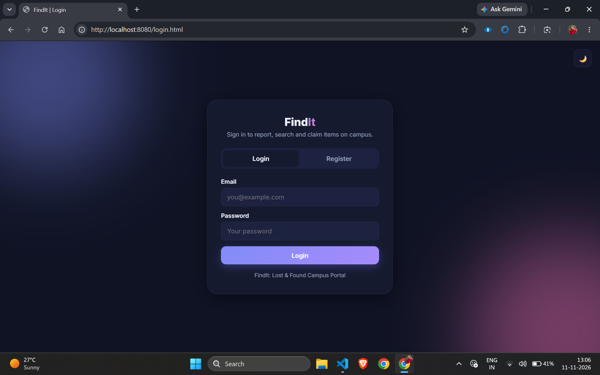
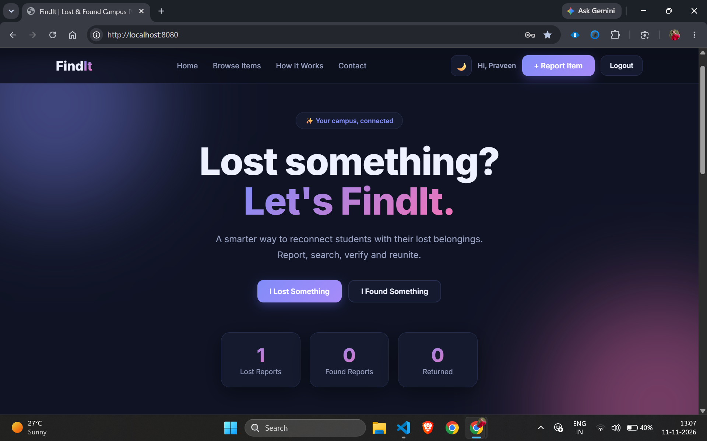
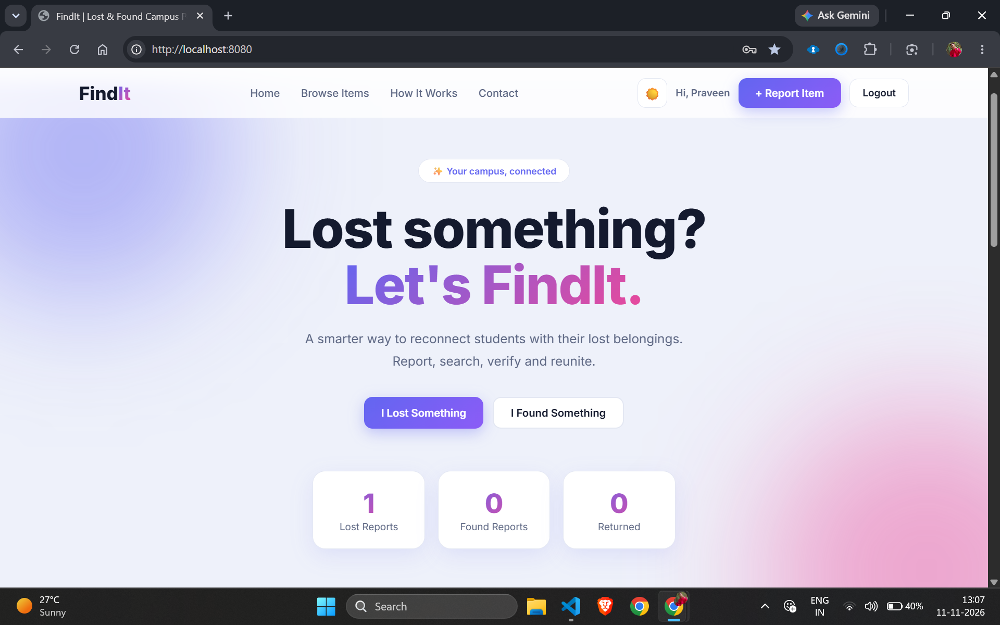
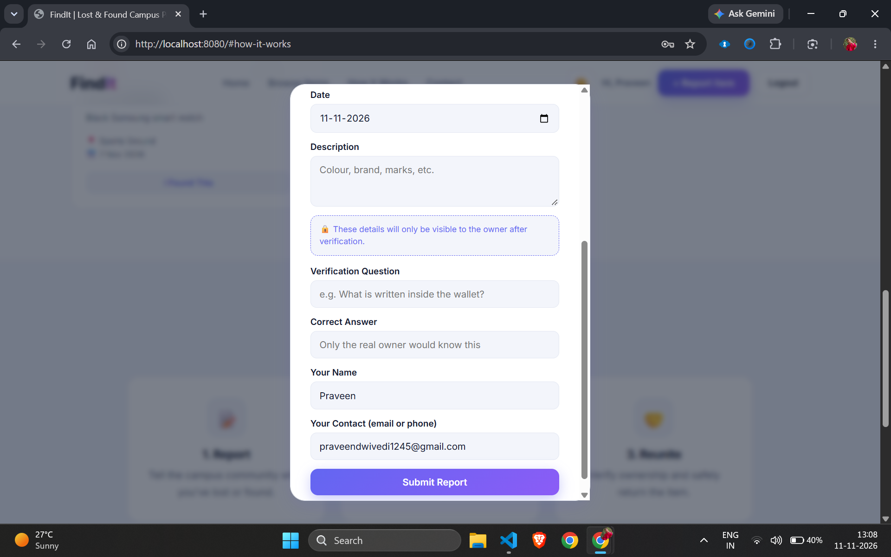
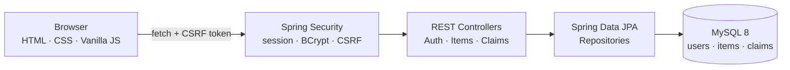
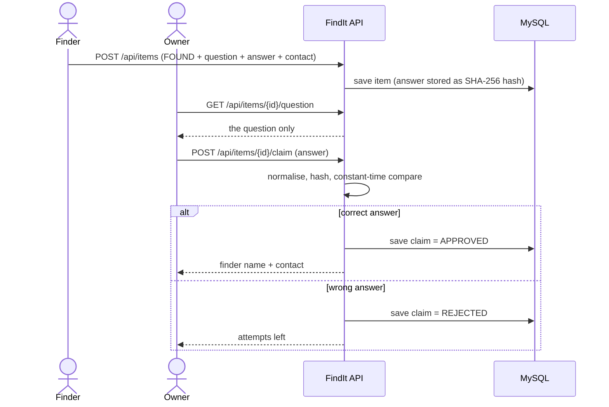
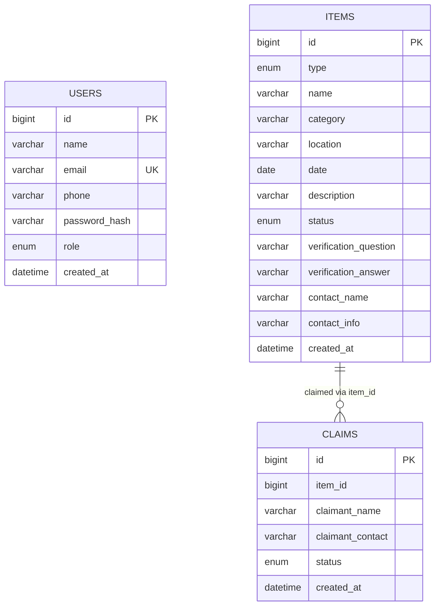

<div align="center">

# 🔎 FindIt

### A secure Lost & Found portal for college campuses

Report what you lost. Post what you found. Get it back by proving it's yours.


</div>

---

## 📌 The problem

On most campuses, lost items end up in a security office with no digital record, get posted in WhatsApp groups that drown in unrelated messages, or never reach their owner at all. Students have no single searchable place to check whether their item has been found, and finders have no easy, safe way to report it.

## 💡 The solution

**FindIt** is a centralised campus portal where any student can post a **Lost** or **Found** report, browse and search a live feed, and claim an item through a **verification flow**: the finder sets a secret question only the real owner can answer, and the finder's contact details stay hidden until the answer is correct. This keeps fake claims out and keeps personal details private.

## 📸 Screenshots

| Login / Register | Dashboard (dark) |
|---|---|
|  |  |

| Dashboard (light) | Claim & verification |
|---|---|
|  |  |

## ✨ Features

**Accounts and security**
- Register, login and logout with server-side sessions
- Passwords hashed with **BCrypt** (salted), never stored in plain text
- **CSRF protection** on every state-changing request
- Every page and API is locked behind login; unauthenticated API calls get `401`

**Lost & Found feed**
- Post **Lost** or **Found** reports with category, campus location, date and description
- Live feed with keyword search and filters by type (Lost / Found) and category
- Dashboard counters for Lost, Found and Returned reports

**Ownership verification (the signature feature)**
- Finder sets a **verification question + answer** when posting a Found item
- The answer is normalised and stored as a **SHA-256 hash**; it is never returned by any API
- Claimant sees only the question; a correct answer reveals the finder's name and contact
- **Brute-force limits:** 3 wrong attempts per claimant per item, 10 per item overall
- Every claim attempt is recorded in the database (result only, never the answer)

**Experience**
- Responsive UI with a **dark / light** theme that remembers your choice
- Friendly validation messages on both client and server

## 🧱 Tech stack

| Layer | Technology |
|---|---|
| Language | Java 21 |
| Framework | Spring Boot 4.1 (Spring Web, Validation) |
| Security | Spring Security: BCrypt, sessions, CSRF |
| Persistence | Spring Data JPA, Hibernate |
| Database | MySQL 8 |
| Build tool | Maven (wrapper included) |
| Frontend | HTML5, CSS3 (custom properties for theming), vanilla JavaScript |

## 🏗️ Architecture



### How a claim works



## 🗄️ Database design



Tables are generated automatically by Hibernate (`ddl-auto=update`).

## 🔌 REST API

All endpoints except the first four require an authenticated session. State-changing requests need the CSRF token from `/api/auth/csrf`.

| Method | Endpoint | Purpose |
|---|---|---|
| `GET` | `/api/auth/csrf` | Get a CSRF token (public) |
| `POST` | `/api/auth/register` | Create an account (public) |
| `POST` | `/api/auth/login` | Log in, starts a session (public) |
| `POST` | `/api/auth/logout` | Log out |
| `GET` | `/api/auth/me` | Currently logged-in user |
| `GET` | `/api/items` | Active feed, newest first |
| `GET` | `/api/items/stats` | Lost / Found / Returned counts |
| `POST` | `/api/items` | Create a Lost or Found report |
| `GET` | `/api/items/{id}/question` | Verification question for a Found item |
| `POST` | `/api/items/{id}/claim` | Submit an answer; reveals contact if correct |

## 🔐 Security design

| Concern | How it is handled |
|---|---|
| Password storage | BCrypt with per-password salt; 8 to 72 character rule |
| Session safety | Session ID is rotated on login to prevent session fixation |
| CSRF | Token required for every POST; fetched fresh by the frontend |
| Verification answers | Trimmed, lower-cased, SHA-256 hashed; compared in constant time |
| Data exposure | Answer hash and finder contact are `WRITE_ONLY` fields, never serialised in responses |
| Brute force on claims | 3 wrong attempts per claimant per item, 10 per item |
| Account enumeration | Login always returns the same generic error message |
| Input validation | Server-side checks and length limits on every field |
| Secrets | Database password lives in `secret.properties`, which is git-ignored |
| XSS | User content is escaped before it is rendered into the page |

## 📁 Project structure

```
findit/
├── README.md
├── docs/screenshots/
└── findit/                                   Maven project
    ├── pom.xml
    └── src/main/
        ├── java/com/praveen/findit/
        │   ├── FinditApplication.java
        │   ├── config/        SecurityConfig
        │   ├── controller/    AuthController, ItemController, ClaimController
        │   ├── entity/        User, Item, Claim
        │   ├── enums/         ItemType, ItemStatus, ClaimStatus, Role
        │   ├── repository/    UserRepository, ItemRepository, ClaimRepository
        │   └── util/          HashUtil
        └── resources/
            ├── application.properties
            └── static/        index.html, login.html, css/, js/
```

## 🚀 Getting started

### Prerequisites
- JDK 21 or newer
- MySQL 8 (Workbench is handy)
- Git

### 1. Clone

```bash
git clone https://github.com/Praveendwivediii/findit.git
cd findit/findit
```

### 2. Create the database

```sql
CREATE DATABASE findit_db;
```

### 3. Add your database password

Create `src/main/resources/secret.properties` (this file is git-ignored):

```properties
spring.datasource.password=YOUR_MYSQL_PASSWORD
```

If your MySQL user is not `root`, change `spring.datasource.username` in `application.properties`.

### 4. Run

```bash
# Windows
.\mvnw.cmd spring-boot:run

# macOS / Linux
./mvnw spring-boot:run
```

Open **http://localhost:8080**. You will be sent to the login page: register an account, log in, and start reporting items.

## 🗺️ Roadmap

- [x] Authentication: register, login, logout (BCrypt, sessions, CSRF)
- [x] Lost and Found reports with search and filters
- [x] Verification-based claims with hidden contact details
- [x] Brute-force limits on claims
- [x] Dark / light theme
- [ ] Multi-page UI (Dashboard, Browse, How it works, Contact)
- [ ] Link reports and claims to the logged-in user
- [ ] "Mark as Returned" and a resolved-items archive
- [ ] Login attempt rate limiting
- [ ] Image upload for items
- [ ] Notifications for claims and approvals
- [ ] Admin dashboard and moderation
- [ ] Rule-based match suggestions between Lost and Found reports
- [ ] Automated tests and Docker deployment
- [ ] Semester II: AI-assisted text and image matching

## ⚠️ Known limitations

This is an actively developed learning project, so a few things are intentionally not done yet:

- Reports are not yet linked to the account that created them, so claimant identity currently comes from the contact typed in the form.
- Login itself has no attempt limit yet.
- Hashed answers are safe from casual viewing, but very short answers can be guessed offline by someone with database access.

## 👤 Author

**Praveen**: MCA student, building FindIt to learn full-stack Java end to end.

- GitHub: [@Praveendwivediii](https://github.com/Praveendwivediii)
- LinkedIn: [your-linkedin-id](https://www.linkedin.com/in/your-linkedin-id)
- Email: your-email@example.com

## 📄 License

Released under the [MIT License](LICENSE).

---

<div align="center">

If this project helped you, consider giving it a ⭐

</div>
